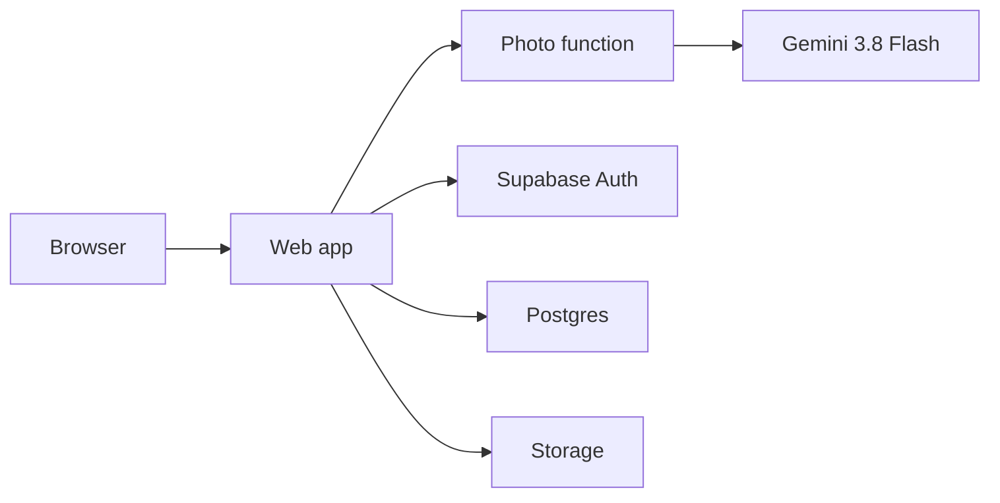

# FoundIt specification

FoundIt is the campus lost-and-found system for the University of Waterloo. Students search every participating desk, report lost and found items, and claim belongings with a pickup code. Desk staff log inventory, enforce holding periods, and approve claims for valuable items.

The running site is [https://foundit-six-iota.vercel.app](https://foundit-six-iota.vercel.app).

## 1. Functional requirements

### 1.1 Visitors

A visitor can browse found items without an account. Public listings show category, colour, a generic description, desk, and age. Valuable items show that generic description only. The public listing hides the name on a WatCard, the contents of a wallet, and any photo of a valuable item.

Visitors can filter by category, building, and age, and open an OpenStreetMap of campus with a pin on each building.

### 1.2 Students

A signed-in student can:

- Report a found item. The item is marked in transit, given a drop-off code, and directed to the nearest open desk.
- Report a lost item with a photo, category, colour, brand, distinctive details, place, and time.
- Receive ranked matches against found items. The student can confirm or reject each match.
- Claim a non-valuable item instantly, up to 3 instant claims per week. The item is reserved for 7 days and the student receives a pickup code.
- Claim a valuable item by answering one private ownership question. Staff approve or reject it.
- Contest an item that another student already reserved. Both claims stay on record for staff.
- Generate a personal return tag (`WAT-…`) for a belonging. A finder who enters the code notifies the owner. The owner's email is not shown to the finder.
- Read an in-app inbox: match alerts, WatCard-name alerts, claim results, pickup reminders when an item is within 5 days of leaving, and a thank-you when an item the student turned in is picked up.

### 1.3 Staff and administrators

Staff see only their assigned desk. An administrator sees every desk.

Staff can:

- Log an item with a photo, category, colour, storage spot, and timestamp. WatCards store the printed name privately and notify a student whose profile name matches.
- See a shift to-do list: items to move, pickups waiting, and claims to approve.
- Age inventory by colour: under 14 days, 14–29 days, and 30 or more days.
- Move an item to long-term storage after 14 days, and release a non-valuable item after 30 days. Valuable items stay at least 60 days. An earlier move or donation requires a recorded supervisor override.
- Approve or reject valuable and contested claims.
- Enter a pickup code, drop-off code, or return-tag code. Pickup closes the record. Drop-off accepts the item into inventory. A return tag notifies the owner.
- Read the timeline of logs, moves, claims, and releases.

### 1.4 Photo recognition

Uploading a photo sends it to Gemini 3.8 Flash. The model returns JSON:

| Field | Meaning |
| --- | --- |
| `category` | One of WatCard, wallet, electronics, keys, bottle, clothing, bag, supplies, other |
| `subcategory` | Finer type, such as charger, calculator, or backpack |
| `colour` | Main colour |
| `brand` | Brand when it is recognizable |
| `distinctiveFeatures` | Stickers, scratches, logos, or other unique marks |
| `description` | Short public description |

The student or staff member confirms or edits those fields before they are saved. If the model is unavailable, the browser still estimates the main colour from the image pixels, and the person fills in the rest.

Matching uses the saved text. It does not compare the image files themselves. A match needs the same category and a score of at least 50 from colour, subcategory, brand, distinctive words, place, and date. A score of 60 or more creates an inbox alert. Two items that share only a category and a colour stay below the threshold.

### 1.5 Holding and claim rules

| Rule | Behaviour |
| --- | --- |
| Desk time | Items stay at the logging desk for 14 days |
| Long-term storage | After 14 days, staff may move the item |
| Donation | Non-valuable items may be released after 30 days |
| Valuables | WatCards, wallets, and electronics other than chargers are held at least 60 days |
| Instant claim | Non-valuable, unclaimed items. Limit 3 per student per week. Hold lasts 7 days |
| Staff review | Valuable items, and any second claim on an item |
| WatCard notice | A private name that matches a profile name creates an inbox notice |

## 2. Non-functional requirements

- **Privacy.** Public rows never include WatCard names, ownership answers, or private notes. Those live in separate tables. Valuable photos go to a private bucket.
- **Authorization in the database.** Row-level security decides who can read and write each row. A student cannot change `profiles.role` or `profiles.desk_id`. Role is not taken from editable user metadata.
- **Secrets stay on the server.** The browser receives only the Supabase publishable key. `GEMINI_API_KEY` is read only by the photo function.
- **Mobile first.** Primary actions fit a phone width. The same screens work on a desk computer.
- **Durability of rules.** Claim limits, holding periods, match scores, and role changes are enforced by database triggers, so a modified client cannot skip them.
- **No confirmation email on signup.** Accounts are created already confirmed, because the hosted mailer allows only two messages an hour.
- **Region.** The database is in Canada (`ca-central-1`). The site is hosted on Vercel.

## 3. Services

FoundIt is four services. The browser talks to the web app, the photo function, and Supabase. Only the photo function talks to Gemini.

| Service | Where it runs | Responsibility |
| --- | --- | --- |
| Web app | Vercel, static Vite build | Student and staff screens. Calls Supabase with the signed-in user's token |
| Photo analysis | Vercel function `POST /api/analyze-photo` | Sends the image to Gemini 3.8 Flash and returns the JSON fields above |
| Supabase Auth | Supabase | Email and password accounts, sessions |
| Supabase Postgres | Supabase | Items, claims, reports, matches, tags, notifications, timelines, and all access rules |
| Supabase Storage | Supabase | `public-photos` and `private-photos` |
| Gemini 3.8 Flash | Google AI | Reads the photo and returns structured item metadata |

## 4. Data flow

### 4.1 Create an account

1. The sign-up form calls `register_account` with name, email, password, student number, and an optional staff code.
2. The function inserts a confirmed user and an email identity, then the new-user trigger creates a `profiles` row with role `student`.
3. A valid staff code updates that profile to `staff` or `admin` and sets the desk. An invalid code cancels the whole signup.
4. The browser signs in with the same email and password. No email is sent.

### 4.2 Photograph and log a found item

1. The browser compresses the photo and calls `POST /api/analyze-photo`.
2. Gemini returns the JSON metadata. The person confirms it.
3. The browser uploads the file to `public-photos` or, for a valuable item, `private-photos`, under that user's folder.
4. The browser inserts `found_items` and, when needed, `found_item_secrets`.
5. A trigger sets the status: `in-transit` plus a `DROP-` code for a student, or `available` for staff at their own desk.
6. The same trigger scores the item against open lost reports, writes `item_matches`, and notifies owners at 60 or above.
7. A WatCard name in `found_item_secrets` notifies every profile with that exact name.

### 4.3 Lost report and match

1. A student inserts `lost_reports`. A reference photo, if any, is stored in `private-photos`.
2. The insert trigger scores the report against items that are not picked up or donated.
3. The student confirms or rejects a row in `item_matches`. Confirming opens the normal claim flow. It does not by itself transfer the item.

### 4.4 Claim and pickup

1. The student inserts `claims`.
2. The trigger either approves it instantly and reserves the item, or marks the item `under-review` and keeps every active claim.
3. Staff set the claim to `approved` or `rejected`. Approval sets the item to `ready-pickup` and issues a `WLO-` code.
4. Staff set the item to `picked-up`. The trigger completes the claim, tells the claimant, and thanks the finder.

### 4.5 Return tag

1. A student inserts `return_tags`. The database assigns a `WAT-` code.
2. A finder inserts `tag_scans` with that code.
3. The trigger notifies the owner. The finder receives only a success message.

## 5. User control

| Actor | How they get the role | What they can do |
| --- | --- | --- |
| Visitor | No account | Read desks, buildings, public item fields, and public timeline events |
| Student | Default for every new account | Own claims, lost reports, matches, return tags, and inbox. Cannot open staff tools |
| Staff | Staff code tied to one desk | Read and update items, secrets, and claims for that desk only |
| Administrator | Staff code with no desk | Same staff rights at every desk |

Staff codes live in `private.staff_invites`, which the Data API cannot read. Current codes:

| Desk | Code |
| --- | --- |
| SLC Front Desk | `SLC-STAFF-2026` |
| DC Library | `DC-STAFF-2026` |
| Dana Porter Library | `DP-STAFF-2026` |
| PAC Equipment Desk | `PAC-STAFF-2026` |
| REV Front Desk | `REV-STAFF-2026` |
| All desks | `CAMPUS-ADMIN-2026` |

Change these before a real launch.

Students may update only `full_name` and `student_id` on their profile. Storage uploads must be stored in a folder named with the uploader's user id. Staff can read private photos. Everyone can read `public-photos`.

## 6. Database schema

Postgres schema `public` is exposed through the API. Schema `private` holds staff codes and the functions that enforce policy. Photos are objects in Storage, referenced by `image_path` and `image_bucket`.

### 6.1 Reference

| Table | Purpose | Important columns |
| --- | --- | --- |
| `desks` | Staffed lost-and-found counters | `id`, `name`, `building`, `room`, `hours`, `map_x`, `map_y` |
| `buildings` | Map pins, including buildings without a desk | `id`, `short_name`, `map_x`, `map_y`, `desk_id` |

### 6.2 People

| Table | Purpose | Important columns |
| --- | --- | --- |
| `auth.users` | Supabase account | `id`, `email`, `email_confirmed_at` |
| `profiles` | Role and weekly claim count | `id`, `full_name`, `role` (`student`, `staff`, `admin`), `desk_id`, `claims_used_this_week` |
| `private.staff_invites` | Desk codes | `code`, `role`, `desk_id`, `active` |
| `staff_redemptions` | Record of a code a user submitted | `user_id`, `code` |

### 6.3 Inventory and claims

| Table | Purpose | Important columns |
| --- | --- | --- |
| `found_items` | Public item record | `title`, `category`, `subcategory`, `colour`, `brand`, `public_description`, `distinctive_features`, `desk_id`, `logged_at`, `status`, `valuable`, `storage_spot`, `drop_off_code`, `image_path`, `image_bucket`, `finder_id` |
| `found_item_secrets` | Staff-only details | `detailed_description`, `watcard_name`, `private_notes` |
| `claims` | One row per claimant | `claimant_id`, `status`, `pickup_code`, `hold_expires_at`, `verification_answer`, `is_contested` |

`found_items.status` is one of `available`, `in-transit`, `reserved`, `under-review`, `ready-pickup`, `picked-up`, `moved-storage`, `donated`.

`claims.status` is one of `pending`, `approved`, `rejected`, `completed`, `contested`.

### 6.4 Reports, matches, and tags

| Table | Purpose | Important columns |
| --- | --- | --- |
| `lost_reports` | A student's lost report | `owner_id`, `category`, `colour`, `brand`, `distinctive_features`, `building`, `lost_at`, `status` |
| `item_matches` | One score per report and found item | `confidence`, `reasons`, `differences`, `status` (`pending`, `confirmed`, `rejected`) |
| `return_tags` | Owner's sticker code | `code`, `label`, `category`, `active` |
| `tag_scans` | A finder entered a code | `scanner_id`, `code` |

### 6.5 Activity

| Table | Purpose | Important columns |
| --- | --- | --- |
| `notifications` | Inbox rows for one user | `type`, `title`, `message`, `read`, `related_item_id`, `pickup_code` |
| `timeline_events` | History of an item or report | `event_type`, `message`, `visibility` (`public` or `staff`) |

Notifications and timeline rows are inserted by triggers. Clients can mark a notification read. They cannot insert either table directly.

## 7. Run and deploy

1. `npm install`
2. Copy `.env.example` to `.env.local`. Set `VITE_SUPABASE_URL` and `VITE_SUPABASE_ANON_KEY`. Set `GEMINI_API_KEY` only for local photo tests.
3. `npm run dev` and open `http://localhost:3000`.

Production build: `npm run build`, output directory `dist`. The Vercel project needs `VITE_SUPABASE_URL`, `VITE_SUPABASE_ANON_KEY`, and `GEMINI_API_KEY`. The Gemini key is a server secret. In Supabase, set the site URL to the Vercel address and allow `https://foundit-six-iota.vercel.app/**` plus `http://localhost:3000/**` as redirect URLs.

Schema source: `supabase/migrations/20261110043000_foundit_init.sql`. Signup without email is the deployed function `public.register_account`.
